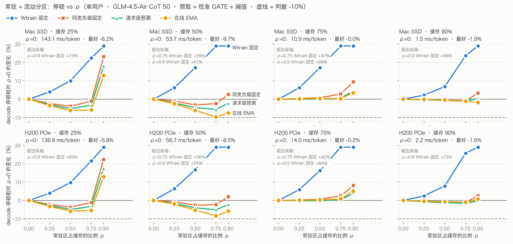

# Report：多用户 MoE 调度 · 阶段 1——单用户 offload：常驻 / 流动缓存、预取机制、使用时顶替

日期：2026-10-22
plan：`plan/2026-10-21-moe-multiuser-scheduling-plan.md` 阶段 1（1.1–1.3；1.4 按方案 C 推迟）
接着：`report/2026-10-21-moe-mu-phase0.md`
机器：masdar 集群 CPU（模拟），没有用 GPU；Mac 写代码、单元测试、画图。

---

## 0. 结论

1. **H1 在模拟里成立，而且不需要在测试集上挑参数。**
   - H1：停顿比"提前 1 层"降 ≥ 30%，同时改动率 ≤ 10%。
   - 用**一组固定配置**跑全部 6 个设置（H200 / Mac × 缓存 25 / 50 / 75%，CoT 50 个请求），最差的设置也降了 41%。这组配置是：LRU + anchor+GATE 预取（阈值随排队负载自适应，参数在 W1 上选定）+ 全局改动率 ≤ 10% 的使用时顶替。
   - 换成校准 GATE 预取，最差降 39%。
   - 改动率压到 5% 时，最差分别降 31% 和 29%，在临界附近。
   - 只顶替、不预取时，最差只降 28%。所以预取和顶替都需要。
   - **前提是准确率**：这是动态顶替，从路由权重最低的迟到 expert 开始换，和 Q3 测过的"固定常驻集"改动分布不同。GLM 长推理对改动敏感，5–10% 是否安全要在阶段 2 用真实模型确认。这是下一步的关口。
2. **常驻 + 流动分区（1.1）：判据没达到。**
   - 判据：存在 ρ > 0 的配置比不分区再降 ≥ 10%。24 个设置里最好的是 −9.7%（Mac 50%，在线 EMA，ρ = 0.75）。
   - 用 Wtrain（短答案）的统计固定填常驻区，在所有设置下都更慢（+4% 到 +111%）。
   - 在线 EMA 最好：缓存 25% 时 −6%，50% 时 −9~−10%，75% 以上基本没有效果。
   - 单用户时 LRU 已经很合适。常驻区原本是为多用户下 LRU 的循环抖动准备的，要到阶段 3 才能检验。
3. **预取机制（1.2）：自适应阈值能从 W1 迁移到 CoT，但最差的设置不过关；浪费判据大多没达到。**
   - 阈值 τ = τ0 + κ·log2(1 + 排队负载)，在 W1 上校准，用到 CoT 上平均拿到"每个设置事后挑最优固定阈值"85–99% 的收益。
   - 24 个设置里 20 个 ≥ 80%。没达到的是 Mac 缓存 75% + LRU（38% / 24%）。
   - 浪费 ≤ 15% 只在缓存 25% 时基本满足；75% 时 17–50%。带宽有富余时，最优策略本来就多取，这条判据和"停顿最小"冲突。
   - 置信度累积、冻结窗口：W1 和 CoT 上都没有收益。按 h 加阈值：配合 moeinf 时有小幅帮助（约 3%）。
   - W1 不是好的校准集，至少对淘汰策略而言：W1 上 moeinf 远好于 LRU（LRU 慢 60–500%），CoT 上缓存 25–50% 时却是 LRU 好 7–8%。所以淘汰策略没有在 W1 上选，LRU 和 moeinf 各自校准、各自测试。
4. **使用时顶替（1.3）：判据达到。** 改动率 ≤ 10% 时，6 个设置都比"提前 1 层"降 41–100%；≤ 5% 时降 31–97%。"换成次优"和"只跳过"的停顿几乎一样，两者的差别在准确率上。
5. **方案 C 的新信息：加上顶替以后，anchor+GATE 比校准 GATE 更有优势。**
   - 不顶替时两者差 ±2%（只有缓存 75% + moeinf 时 anchor 好约 7%）。
   - 改动率 10%、LRU 时，anchor+GATE 的停顿再低 3–14%（缓存 25–50%）。
   - 原因待查。一个可能：顶替只能换成"已读完"的 expert，预取越准，剩下要顶替的越少。所以带宽和改动预算都紧时，预测精度更值钱。

---

## 1. 常驻 + 流动分区（1.1）

### 1.1 设置

- **填法**（统计数据都来自测试集之外）：

| 填法 | 做法 |
|---|---|
| Wtrain 固定（R-glob） | Wtrain（短答案 KGQA）decode 中最常用的（层, expert） |
| Wtrain 每层配额（R-layer） | 同样的计数，每层分到相同的名额 |
| 同类负载固定（R-work） | CoT 第 51–200 个请求（v3）的计数；测试是前 50 个，代码里有断言检查两者不重叠 |
| 在线 EMA（R-ema） | 实际 decode 用量的指数滑动平均，每 N 个 token 刷新，每次最多换 s 比例；两组参数事先定好：慢（N=64、半衰期 256、s=10%）、快（16 / 64 / 5%） |
| 请求级预测（R-pred） | 请求到达时，用它 prefill 的 expert 分布在校准请求里找 8 个最近邻，取它们 decode 的 expert 分布；每个请求开始时换一次 |

- **常驻区刷新**：换出的 expert 转入流动区，不会立即丢弃；换入的走最低优先级的后台加载。
- **扫描**：CoT 50 × {Mac, H200} × 缓存 {25, 50, 75, 90%} × ρ ∈ {0, .25, .5, .75, .9} × 6 种填法 × 3 种预取（不预取、阶段 0 最优的校准 GATE、最优的 anchor+GATE），C2 开，共 600 组。

### 1.2 结果

每种填法在 4 个 ρ 中最好的那个（预取 = 校准 GATE）：

| 硬件 | 缓存 | ρ=0 停顿 | Wtrain 固定 | 同类负载固定 | EMA 慢 | EMA 快 | 请求级预测 |
|---|---|---|---|---|---|---|---|
| Mac | 25% | 143.1 | +4.0% | −3.8% | −5.3% | **−6.2%** | −5.1% |
| Mac | 50% | 53.8 | +6.3% | −3.1% | −6.7% | **−9.7%** | −5.5% |
| Mac | 75% | 10.9 | +6.3% | +0.4% | +0.3% | +0.1% | **−0.0%** |
| Mac | 90% | 1.5 | +2.3% | −0.8% | −0.4% | **−1.9%** | −1.2% |
| H200 | 25% | 136.9 | +3.9% | −3.7% | −5.0% | **−5.8%** | −4.9% |
| H200 | 50% | 56.7 | +6.4% | −2.6% | −5.8% | **−8.5%** | −5.1% |
| H200 | 75% | 14.0 | +5.9% | +0.2% | +0.3% | +0.1% | **−0.2%** |
| H200 | 90% | 2.2 | +2.5% | −1.1% | −0.7% | −1.0% | **−1.6%** |

（完整表，含不预取和 anchor+GATE 两种预取：`outputs/moe/mu/p11/p11_tables.md`。三种预取下的规律相同。）

- **按别的负载固定填，有害**：ρ 越大越慢，ρ = 0.9 时 +61% 到 +111%。短答案和长推理 decode 用到的 expert 差别很大。
- **按同类负载固定填，帮助很小**：ρ = 0.5 时最多 −4%，ρ = 0.9 时变慢。每个 CoT 请求用到的 expert 也各不相同，一组固定的装不下。
- **在线 EMA 最好**，快的那组好于慢的；请求级预测居中（−5%）。
- 缓存 ≥ 75% 时，任何分区都几乎没有作用。
- 注意：每格里"最好的 ρ"是在测试集上挑的，所以这已经是偏乐观的估计。

---

## 2. 预取机制（1.2）

### 2.1 实现

预取策略字符串新增选项（不加时和原行为逐数相同，单元测试有检查）：
- `:g<γ>`：置信度累积。同一目标层的几次预测按 γ^(h−1) 加权平均；不加时只看最新一次。
- `:d<d>:x<τ_high>`：冻结窗口。离目标层 ≤ d 层时不再撤销已排队的加载，新增的要求置信度 ≥ τ_high。
- `:k<κ>` / `:kl<κ>`：自适应阈值。τ = τ0 + κ × 负载，或 τ0 + κ × log2(1 + 负载)。负载 = 排队中的预取数 ÷ 每层能读入的 expert 数。
- `:hl<δ>`：提前 1 层的预测阈值另加 δ（阶段 0 发现只在 h=1 才进入队列的加载最不可靠）。

### 2.2 步骤（参数一律在 W1 上选，CoT 只做测试）

| 步 | 负载 | 内容 | 选择 |
|---|---|---|---|
| A | W1 + CoT | γ ∈ {只看最新, .5, .7, 1} × 4 个 τ0 × {lru, moeinf} × 6 个设置 | 按 W1 选 γ：GATEs 和 AVG/moeinf 只看最新，AVG/lru γ = .5（只好 0.35%） |
| B | W1 | τ0 × κ（线性 .005–.04、对数 .05–.2），4 个（预测器, 淘汰）家族，864 组 | 每个家族选一组在 6 个设置上平均差距最小的配置；四个家族选中的都是对数形式 |
| C | W1 | 冻结 d ∈ {1,2,3} × τ_high，按 h 加阈值 δ ∈ {.2,.4} | 冻结在所有家族、设置下都更慢（+1% 到 +15%），不选；δ = .2 只选给能受益的三个家族 |
| D | CoT | 最终配置 + 消融 | – |

**排队负载的分布**（W1 和 CoT 量级相近，适合在 W1 上校准）：缓存 25% 时中位约 16–32，50% 时 4–16，75% 时约 0.5。阶段 0 在 CoT 上事后挑出的最优阈值正好也是：25% 时最高，75% 时最低。

**W1 和 CoT 的淘汰策略偏好相反**（各设置最好的停顿，ms/token）：

| | H200 25% | H200 50% | H200 75% | Mac 25% | Mac 50% | Mac 75% |
|---|---|---|---|---|---|---|
| W1：lru / moeinf | 176 / 107 | 108 / 42 | 49 / 11 | 188 / 111 | 116 / 39 | 53 / 9 |
| CoT：lru / moeinf | 136 / 147 | 55 / 59 | 13.2 / 13.0 | 142 / 153 | 53 / 57 | 10.9 / 10.5 |

W1 每个请求平均只 decode 约 5.6 个 token，缓存几乎完全由 prefill 决定，请求内的使用计数（moeinf）占优；长 decode 时 LRU 的时间局部性更有用（P3 也观察到）。所以淘汰策略不在 W1 上选，两种分别校准、分别在 CoT 上比较。

**W1 上选定的最终配置：**

| 家族 | 配置 |
|---|---|
| 校准 GATE / LRU | `ah8:GATEs:m8:p0.7:kl0.05` |
| 校准 GATE / moeinf | `ah8:GATEs:m8:p0.3:kl0.1:hl0.2` |
| anchor+GATE / LRU | `ah8:AVG:m8:p0.7:g0.5:kl0.1:hl0.2` |
| anchor+GATE / moeinf | `ah8:AVG:m8:p0.3:kl0.1:hl0.2` |

在 W1 上，LRU 下的自适应比"每个设置事后挑的固定阈值"还再好 4.0%（GATEs）/ 1.2%（AVG），因为阈值在一次运行内部也随负载变化。

### 2.3 CoT 测试（判据）

自适应 ÷ 事后最优固定阈值的收益。收益 = 提前 1 层的停顿 − 该配置的停顿；事后最优取 CoT 上同家族全部固定阈值配置（含阶段 0 的扫描）中最好的那个：

| 家族 | H200 25% | H200 50% | H200 75% | Mac 25% | Mac 50% | Mac 75% | 平均 |
|---|---|---|---|---|---|---|---|
| 校准 GATE / LRU | 100% | 103% | 97% | 103% | 101% | **38%** | 90% |
| 校准 GATE / moeinf | 96% | 98% | 104% | 103% | 109% | 83% | 99% |
| anchor+GATE / LRU | 102% | 101% | 90% | 104% | 90% | **24%** | 85% |
| anchor+GATE / moeinf | 95% | 96% | 103% | 98% | 107% | 97% | 99% |

预取浪费（预取加载中没被用到的比例）：

| 家族 | 25% | 50% | 75% |
|---|---|---|---|
| 校准 GATE / LRU | 12–14% | 17–18% | 27–29% |
| 校准 GATE / moeinf | 14% | 24–25% | 45–50% |
| anchor+GATE / LRU | 6–7% | 11–14% | 17–21% |
| anchor+GATE / moeinf | 16–20% | 23–26% | 40–45% |

- **判据 1（≥ 80%）**：四个家族的平均都达到；最差的设置没达到（Mac 75% + LRU）。原因是 W1 给 LRU 选的 τ0 = 0.7 在低负载时偏高，而 CoT 在这个设置下的最优阈值只有 0.3–0.5；W1 上缓存 75% 时排队也很短，没能把这一点校准出来。
- **判据 2（浪费 ≤ 15%）**：大多没达到。缓存 75% 时多取本来就更快，这条判据只适合带宽受限的情况。

### 2.4 消融（1.2.4；CoT；相对最终配置，6 个设置的平均 / 最差）

| 家族 | 去掉自适应（只留 τ0） | 换成 W1 选的固定阈值 | 去掉按 h 加阈值 | 去掉 γ | 加冻结 d=1 |
|---|---|---|---|---|---|
| 校准 GATE / LRU | +1.3% / +4.7% | +1.3% / +4.7% | – | – | +2.7% / +5.0% |
| 校准 GATE / moeinf | +11.7% / +18.9% | +3.9% / +10.1% | +2.6% / +6.4% | – | +6.4% / +8.6% |
| anchor+GATE / LRU | −1.6% / +1.6% | +0.5% / +1.7% | −1.4% / +0.2% | −1.2% / +0.0% | −0.9% / +0.5% |
| anchor+GATE / moeinf | +13.4% / +18.9% | +6.7% / +9.5% | +3.3% / +6.1% | – | +6.0% / +8.9% |

- 自适应阈值对 moeinf 最关键：只留 τ0 = 0.3 时，高负载下取得太多。
- anchor+GATE / LRU 在 W1 上额外选中的三项（γ、δ、自适应），在 W1 上各只赢 0.2–0.4%，到 CoT 上都变成小幅负收益：在很小的差距上过拟合了 W1。
- 冻结窗口几乎总是有害（只有 anchor+GATE / LRU −0.9%），和阶段 0 的浪费分解一致：被后来修正的预测本来就少。

### 2.5 补充（2026-10-24）：换成 CoT 校准子集

按你的决定，用 CoT 第 51–72 个请求（v4，和测试的前 50 个不重叠）代替 W1 重做 B 步，每个家族按同样的规则（6 个设置平均差距最小）选一组，再在前 50 个请求上测试：

| 家族 | W1 选的 → 平均 / 最低 | CoT 子集选的 → 平均 / 最低 | 预取浪费 |
|---|---|---|---|
| anchor+GATE / LRU | `p0.7:g0.5:kl0.1:hl0.2` → 85% / 24% | `p0.3:g0.5:kl0.15` → **100% / 96%** | 16–42% |
| anchor+GATE / moeinf | `p0.3:kl0.1:hl0.2` → 99% / 95% | `p0.3:kl0.15` → 95% / 90% | 19–44% |
| 校准 GATE / LRU | `p0.7:kl0.05` → 90% / 38% | `p0.7:k0.01` → 92% / 50% | 17–32% |
| 校准 GATE / moeinf | `p0.3:kl0.1:hl0.2` → 99% / 83% | `p0.5:kl0.1` → 90% / 76% | 20–42% |

- 用同类型的校准集后，anchor+GATE 两个家族在全部 6 个设置都达到 80% 判据；原来失败的 Mac 75% + LRU 从 24% 升到 98%（基础阈值从 0.7 降到 0.3）。
- 校准 GATE 仍有设置不过。另外"平均差距最小"这条事先定的规则，在 GATEs/LRU 上选中了一个 Mac 75% 很差的配置；同一家族里 `p0.5:kl0.1` 的平均差距几乎一样（3.07% 对 3.02%），最差只差 7.4%。这说明选择规则本身也需要考虑最差情况。
- 和阶段 1 的观察一致：anchor 对阈值不敏感，参数迁移时更稳。
- 代价：基础阈值更低，预取浪费更高（16–42%）。

---

## 3. 使用时顶替（1.3）

### 3.1 实现

- **"迟到"**：本层要用的 expert 不在缓存，或正在读、到用时还没读完。
- **顶替**：按路由权重从小到大，在预算内把迟到的 expert 换成"已缓存且已读完、不在本 token 的 top-k 里、router 打分最高"的 expert。
  - 单用户时每个 token 每层仍算 k 个 expert，计算量不变。
  - 被换掉的 expert 如果还在排队，就撤销它的加载；已经在读的继续读。
- **预算**：每 token 每层最多 b 个，或全局改动率（已改动的使用 ÷ 全部使用）≤ ρ_c 在线控制。按层分配预算要等阶段 2 的准确率数据。
- **对照**：`skip:` 只丢弃不替换（Q1 的近似）。
- **记录**：逐条记录（请求、token、层、原 expert、替换 expert），见 §3.3。

### 3.2 结果（CoT 50；停顿 ms/token，括号里是相对提前 1 层）

| 设置 | 提前 1 层 | 最好的预取，不顶替 | + 改动 ≤ 2% | ≤ 5% | ≤ 10% | 每 token 每层 ≤ 1（改动率） |
|---|---|---|---|---|---|---|
| H200 25% | 169.9 | 135.2（−20%） | 128.3（−24%） | 117.9（−31%） | 101.0（−41%） | 93.9（11.9%，−45%） |
| H200 50% | 71.4 | 54.9（−23%） | 48.1（−33%） | 38.3（−46%） | 23.2（−67%） | 25.8（8.7%，−64%） |
| H200 75% | 17.3 | 12.9（−25%） | 7.8（−55%） | 1.9（−89%） | ≈0（−100%） | 3.5（3.8%，−80%） |
| Mac 25% | 176.2 | 140.0（−21%） | 132.1（−25%） | 120.2（−32%） | 100.7（−43%） | 93.5（11.7%，−47%） |
| Mac 50% | 66.6 | 53.6（−19%） | 46.2（−31%） | 34.5（−48%） | 17.2（−74%） | 23.1（7.9%，−65%） |
| Mac 75% | 14.0 | 10.6（−24%） | 4.6（−67%） | 0.5（−97%） | ≈0（−100%） | 2.2（2.7%，−84%） |

（完整表：`outputs/moe/mu/p13/p13_tables.md`。2026-10-23 修正：全局改动率预算原来按层顺序累积并取整，45 层 × 8 × ρ 恰为整数，导致每个 token 总是同一批层拿到名额；改为随机偏移取整后重跑（`p13_cot_v2.json`），停顿的中位变化在 ±0.2% 以内，个别停顿很小的设置在 −8% 到 +3%，结论不变，表中是重跑后的数字。）

**用一组固定配置跑全部 6 个设置**（H1 的严格版本：不在测试集上挑任何东西）：

| 配置 | 改动 ≤ 5%：最差 / 各设置 | 改动 ≤ 10%：最差 |
|---|---|---|
| LRU + anchor+GATE 自适应 | **−31%** / −31 −46 −88 −32 −48 −91% | **−41%** |
| LRU + 校准 GATE 自适应 | −29% / −29 −43 −82 −31 −46 −89% | **−39%** |
| moeinf + 校准 GATE 自适应 | −22% | **−30%** |
| LRU，不预取 | −17% | −28% |

- **H1 成立**：改动 ≤ 10% 时，LRU + 自适应预取（两种预测器都行）在所有设置都降 ≥ 39%。
- 改动 ≤ 5% 时只有 anchor+GATE 刚好过线。
- 顶替单独用不够：缓存 25% 时只降 29%。
- 每 token 每层 ≤ 1 的预算：改动率随缓存大小在 3–12% 之间变化，缓存 25% 时超过 10%。所以要按改动率控制，不能只按每层个数。
- **加上顶替后，两种预测器拉开了**（anchor+GATE 相对校准 GATE 的停顿，LRU）：

| | H200 25% | H200 50% | H200 75% | Mac 25% | Mac 50% | Mac 75% |
|---|---|---|---|---|---|---|
| 不顶替 | −1.1% | −1.8% | −3.9% | −0.6% | +1.1% | +2.4% |
| 改动 ≤ 10% | −2.8% | −11.8% | −20.4%* | −2.6% | −14.0% | −22.0%* |

（* 绝对值很小：0.7 对 0.8 ms/token。）

### 3.3 顶替记录（1.3.3，供阶段 2 回放）

- 文件：`outputs/moe/subst/records_glm_cot/*.npz`（集群）。
- 覆盖：GLM CoT 50 个请求 × {Mac, H200} × 缓存 {25, 50%} × {校准 GATE / LRU，anchor+GATE / LRU} × {改动 ≤ 2%, 5%, 10%, 每 token 每层 ≤ 1}。
- 每个文件存 `records [n, 5]`：请求、token、层、原 expert、替换 expert；另存请求名 `stems`。

---

## 4. 判据汇总

| 判据 | 结果 |
|---|---|
| 1.1：存在 ρ > 0 再降 ≥ 10% | **没达到**（最好 −9.7%） |
| 1.2：自适应达到事后最优的 ≥ 80% | **平均达到（85–99%），最差设置没达到**（Mac 75% + LRU：24–38%） |
| 1.2：浪费 ≤ 15% | **大多没达到**（只在缓存 25% 时基本满足） |
| 1.3：改动 ≤ 10% 时比提前 1 层降 ≥ 30% | **达到**（41–100%） |
| H1：不事后挑参数，降 ≥ 30% 且改动 ≤ 10% | **在模拟中达到**（一组固定配置，最差 −41%）；准确率未测 |
| H2：浪费 ≤ 15% | 同 1.2，大多没达到 |
| H3：池子缩到 20% 时 recall 掉 ≤ 1 pt 等 | 推迟（1.4，方案 C） |

---

## 5. 局限

1. **准确率完全没测**。5–10% 的改动率在 GLM 长推理上是否安全，是 H1 能否成立的关键（阶段 2）。
2. **只有单用户**；常驻区、组 batch 的主要价值在多用户（阶段 3）。
3. **W1 作为校准集有结构性缺陷**：decode 太短，淘汰策略偏好相反，也没能校准出低负载时的阈值（Mac 75% 失败的原因）。如果之后的自适应参数继续在 W1 上校准，类似的失败还会出现。可以考虑用 CoT 第 51–72 个请求（v4 已采）作为同类型的校准集，需要你同意。
4. **淘汰策略仍要按缓存大小选**（25–50% 用 LRU，75% 用 moeinf）。§3.2 的固定配置用 LRU，在 75% 时靠顶替弥补，不靠淘汰。
5. **阈值、负载的单位依赖硬件参数**：负载按"每层能读入的 expert 数"归一，在 Mac 和 H200 上共用一组参数可行；换别的硬件需要重新检查。
6. **模拟器的乐观之处**：单个加载通道、无匹配开销（anchor 的近邻搜索没有计入，1.4 推迟）、顶替的计算成本按"仍是 k 个 expert"计。

## 6. 下一步

1. **阶段 2（GPU）：顶替的准确率。** 回放 §3.3 的记录到 GLM，测 CoT 的准确率；GSM8K 和 Qwen3 thinking 用"按统计的每层改动率随机施加"。先回答：改动 5% / 10% 时 GLM 长推理掉多少。
2. 如果 GLM 长推理在 5% 时就明显掉点，H1 只能在更低的改动率下成立。这时 anchor+GATE 的精度优势（§3.2）更重要，可能需要回头重新评估 1.4。
3. 校准集问题（§5.3）请你决定：继续用 W1，还是加一个 CoT 校准子集。

## 7. 过程记录

| 问题 | 处理 |
|---|---|
| 1.1 扫描的等待脚本报"失败" | 实际跑完了；`grep -l` 没找到错误日志时返回 1，之后都加了 `\|\| true` |
| matplotlib 不在任何环境里 | 装进 Mac 的 `.venv-mac`（不影响 MLX）；集群环境没动 |
| 自适应阈值的 κ 不知道取什么量级 | 先在模拟器里记录排队负载的分布（W1 全部 + CoT 10 个请求），再定网格；负载长尾，所以加了对数形式 |
| `p12d` 里有一条策略重复出现 | "去掉自适应"和"W1 选的固定阈值"恰好是同一个配置；重复行不影响结果 |
| VPN 断了约 7 小时 | 任务都在 tmux 里，没有受影响 |
