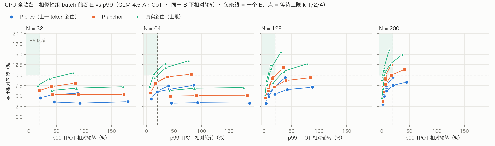
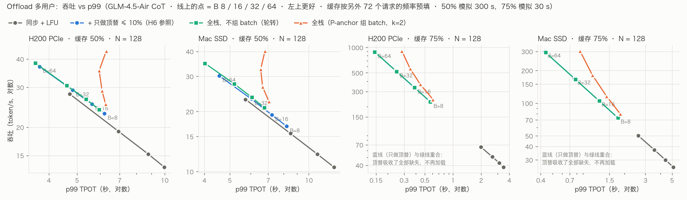

# Report：多用户 MoE 调度 · 阶段 3——多用户（组 batch、offload 全栈）

日期：2026-10-26
plan：`plan/2026-10-21-moe-multiuser-scheduling-plan.md` 阶段 3（3.1–3.3）
接着：`report/2026-10-22-moe-mu-phase1.md`（单用户），`report/2026-10-24-moe-mu-phase2-key.md`（顶替的准确率）
机器：masdar 的 CPU（模拟器，最多 90 个进程），不用 GPU。

---

## 0. 结论

1. **下一 token 预测（3.1）达标。** P-anchor 拿到"按真实路由组 batch"收益的 78–83%（判据 ≥ 75%），P-prev 只有 58–63%。
2. **GPU 全驻留时只做组 batch（H5）：只在大池子达标。**
   - p99 增加 ≤ 20% 时，P-anchor 在 N=200 时吞吐 +10.0% / +12.5%（B=32 / 16）；
   - N=128 时 +9.2–9.6%，N ≤ 64 时 +6–8%；
   - 即使按真实路由挑，上限也只有 +7.6%（N=32）到 +16.1%（N=200）。
3. **Offload 全栈（H6）：只在"缓存 50% + Mac SSD"达标，H200 PCIe 和 75–90% 的缓存都没达到。**

   | 硬件 · 缓存 | 相同 B、p99 不高于参照时，全栈比"同步 + LFU + 只做顶替"多 | 不限 B 的前沿 |
   |---|---|---|
   | Mac SSD · 50% | **8/8 个设置 ≥ +15%，中位 +32%** | +15.2% / +15.4%（刚过线） |
   | H200 PCIe · 50% | 0/8，中位 +4.7%（最好 +11.3%） | +3.7% / +3.8% |
   | 两种硬件 · 75% / 90% | 0/32；有可比点的 28 个在 −1.6% 到 −0.1%，另 4 个（Mac 75%、B ≥ 32）全栈的 p99 都高于参照 | 无增益 |

4. **"使用时顶替"几乎是全部收益的来源；缓存 ≥ 75% 时，它让系统根本不再加载。**
   - 顶替 ≤ 10% 让吞吐提升：50% 缓存 +50–56%，75% 缓存 +306–810%，90% 缓存 +65–169%。
   - 缓存 ≥ 75% 时，按另外 72 个请求的频率预填缓存后，缺失的 expert 全部能被顶替掉：实际改动 6.3% / 1.3%，没有一次加载，GPU 100% 忙。
   - 所以在这个区间里，预取、常驻区、保护都没有事可做，剩下的提升只能来自组 batch。
5. **其他组件：**
   - **组 batch**：吞吐 +8–11%，但 p99 +40–44%。offload 时 B 越大越好，所以组 batch 只在 B 受限时有意义（见 3.3b）。
   - **多层预取**：只在 50% 缓存时有用，Mac +25%、H200 +6.5%。缓存 75% / 90% 时，它在 Mac 上把改动率从 6.4% / 1.3% 降到 4.3% / 0.7%（H200 上 6.3% / 1.2% → 6.0% / 0.8%），但吞吐少 0.1–1.7%。
   - **常驻区（EMA，ρ=.5）**：−1.3% 到 0，没有用。阶段 1 的 1.1 就没达标，多用户下也一样。
   - **C2 保护**：0 到 +0.2%，可以不做，和阶段 0.4 一致。
6. **阶段 2 补充：Qwen3 thinking 200 题，改动 5% / 10% 都没有掉点。**
   - 5%：.895；10%：.910；基线 .900。
   - 逐题配对：对变错 / 错变对分别是 5/4、7/9；差 −0.5 / +1.0 pt，95% 区间约 ±3–4 pt。
   - 阶段 2 关键实验里 50 题的"5–10% 往下掉"是波动。
   - 200 题只能排除约 3 pt 以上的掉点；要确认"掉 ≤ 1 pt"需要更多题。

---

## 1. 设置

- **负载**：GLM-4.5-Air bf16、W2c CoT 的 v3 trace，共 200 个请求。
  - 前 128 个请求（decode ≥ 64 token）作为 N 个并发流，每个流从随机位置开始，结束后从头循环。
  - 后 72 个请求作为校准集，用于缓存预填和常驻区的初始统计。
- **模拟器**：`tsim_mu.py` 的 pool 模式。同步 batch：每步从 N 个流里挑 B 个前进一个 token；每层先算 gate，再加载缺的 expert，再计算。
  - 时间参数用实测的微基准：H200 PCIe 每个 expert 加载 1000 µs；Mac SSD 1150 µs。
  - 缓存容量 = f × 45 层 × 128 个 expert。
- **消融的各个组件**（参数都是事先定好的，没有在这里调）：

| 组件 | 设置 |
|---|---|
| 流动区 | LFU（阶段 3.3a：多用户下 LRU 抖动，比 LFU 低 21–66%） |
| 使用时顶替 | 全局改动率 ≤ 10%，随机取整（阶段 1.3） |
| 组 batch | P-anchor 预测下一 token 的 expert，贪心挑并集最小的 B 个流；等待上限 k = 2（曲线里扫 1 / 2 / 4） |
| 常驻区 | ρ = .5，在线 EMA（每 16 token 刷新、半衰期 64、每次最多换 5%） |
| 多层预取 | anchor + GATE 投票（AVG），提前 8 层，前 8 个，阈值 .3，置信度累积 γ=.5，对数自适应阈值 κ=.15（阶段 1.2 在 W1 上选的） |
| 保护 | C2：已缓存且被预测要用的 expert 不被淘汰（plan 里的"冻结窗口"在阶段 1.2 无益，没有放进来） |

- **指标**：吞吐（token/s）；每个 token 的 TPOT 的 p50 / p99。
- **模拟时长**：缓存 50% 时模拟 300 s；75 / 90% 时 30 s，那时每步只要 0.1–1 s，30 s 已有数百步。

## 2. 结果

### 2.1 下一 token 预测（3.1）

| 预测器 | recall@8 | 拿到上限收益的比例（各 N、B 平均） |
|---|---|---|
| P-prev（上一 token 的路由） | .342 | 58–63% |
| **P-anchor**（上一 token 的打分找近邻，投票近邻下一个 token 的路由） | **.513** | **78–83%** |
| P-mix（投票 + 0.5 × 上一 token） | .490 | 69–77% |

P-mix 的 β 是事先定的，偏向上一 token 太多，所以反而不如 P-anchor。

### 2.2 GPU 全驻留：只做组 batch（3.2）

- 只有 N=200 时，P-anchor 有点落进 H5 区域（p99 ≤ +20%、吞吐 ≥ +10%）。
- 等待上限 k 越大，吞吐涨得很少，p99 却涨得很多。
- 池子小时，就算按真实路由挑，收益也小。这和 arXiv 2608.07911 报告的 miss 只降 4.6–4.8% 一致。
- 可变 B（新增 expert 超过阈值就少挑几个）没有用：每步 token 少了，但步时间没有按比例缩短。

### 2.3 Offload 全栈消融（3.3）

各行吞吐 / p99 相对"只做顶替"那一行，在同一（硬件、缓存、N、B）下比较，再对 N ∈ {64, 128} × B ∈ {16, 32} 取几何平均。括号里是实际改动率。

**H200 PCIe**

| 配置 | 缓存 50% 吞吐 / p99 | 75% 吞吐 / p99 | 90% 吞吐 / p99 |
|---|---|---|---|
| 基线：同步 + LFU | −35.8% / +48% | −89.0% / +857% | −62.8% / +195% |
| + 只做顶替（参照） | 26.5 tok/s（10.0%） | 429 tok/s（6.3%，0 次加载） | 404 tok/s（1.2%，0 次加载） |
| + 组 batch | +11.2% / +41% | +7.8% / +44% | +8.1% / +43% |
| + 常驻 / 流动 | +9.8% / +42% | +7.8% / +44% | +8.1% / +43% |
| + 多层预取 | +17.0% / +34% | +7.7% / +44%（6.0%） | +7.7% / +44%（0.8%） |
| 全栈（+ C2） | +17.1% / +34% | +7.7% / +44% | +7.7% / +44% |
| 全栈 − 组 batch | +4.8% / **−4%** | −0.2% / +0% | −0.4% / +0% |
| 全栈 − 顶替 | −26.8% / +103% | −86.6% / +1155% | −52.0% / +246% |

**Mac SSD**

| 配置 | 缓存 50% 吞吐 / p99 | 75% 吞吐 / p99 | 90% 吞吐 / p99 |
|---|---|---|---|
| 基线：同步 + LFU | −33.6% / +44% | −75.4% / +322% | −39.3% / +74% |
| + 只做顶替（参照） | 20.7 tok/s（10.0%） | 138 tok/s（6.4%，0 次加载） | 129 tok/s（1.3%，0 次加载） |
| + 组 batch | +11.3% / +42% | +8.8% / +43% | +9.1% / +43% |
| + 常驻 / 流动 | +9.9% / +43% | +8.8% / +43% | +9.1% / +43% |
| + 多层预取 | +37.1% / +17% | +6.9% / +46%（4.3%） | +8.4% / +44%（0.7%） |
| 全栈（+ C2） | **+37.3% / +17%** | +6.9% / +46%（4.3%） | +8.4% / +44%（0.7%） |
| 全栈 − 组 batch | **+19.7% / −15%** | −1.9% / +2%（4.5%） | −0.6% / +1%（0.7%） |
| 全栈 − 顶替 | −19.0% / +86% | −65.7% / +387% | −21.8% / +107% |

**每个组件单独的贡献**（吞吐比，加上它对比加之前；N × B 的几何平均）：

| 硬件 · 缓存 | 顶替 | 组 batch | 常驻区 | 多层预取 | C2 | 全栈对去掉组 batch | 全栈对去掉顶替 |
|---|---|---|---|---|---|---|---|
| H200 · 50% | +55.9% | +11.2% | −1.2% | +6.5% | +0.1% | +11.7% | +59.9% |
| Mac · 50% | +50.5% | +11.3% | −1.3% | **+24.8%** | +0.2% | +14.7% | +69.5% |
| H200 · 75% | +810% | +7.8% | 0 | −0.1% | 0 | +7.9% | +706% |
| H200 · 90% | +169% | +8.1% | 0 | −0.4% | 0 | +8.1% | +124% |
| Mac · 75% | +306% | +8.8% | 0 | −1.7% | 0 | +8.9% | +211% |
| Mac · 90% | +64.9% | +9.1% | 0 | −0.6% | 0 | +9.1% | +38.6% |

为什么多层预取在 Mac 上有用得多：
- H200 PCIe 上，"只做顶替"时加载通道已经 93% 忙，计算只占 7%。能藏到计算后面的加载很少。
- Mac 上计算占 16%（加载通道 84% 忙），有空闲可以填；而且预取到的 expert 让改动预算可以用到别处。

### 2.4 H6：相同 p99 下的比较

- **比较方法**：
  - 参照点："只做顶替"、轮转挑选、某个 B。
  - 全栈候选：同一 B 下，挑选方式取"轮转"或"P-anchor，k = 1 / 2 / 4"。
  - 在 p99 不超过参照 2% 的候选里，取吞吐最高的那个。2% 是模拟噪声的容差。
- **Mac 50%**：
  - B ≤ 16（以及 N=128、B=32）时，最好的是 P-anchor 组 batch，+31–38%。预取把 p99 降下来，抵消了组 batch 拉长的 p99。
  - N=64、B=32 和 B=64 时，最好的是轮转，+15–18%。
- **H200 50%**：大多数设置只有轮转版能满足 p99，+4–5%。N=128、B ≤ 16 时 P-anchor 有 +9.9% / +11.3%。
- **75 / 90% 缓存**：全栈在相同 p99 下比参照低 0.1–1.6%。这些设置里没有加载，预取只会让加载通道去抢资源。

**前沿比较（不限 B）**：offload 时 B 越大，吞吐越高、p99 越低（一次加载服务更多 token），所以两边的最佳点都在 B = 64 的轮转。这时组 batch 不起作用，差别只来自预取和常驻区：Mac 50% +15.2% / +15.4%，H200 50% +3.7% / +3.8%。

所以，组 batch 的价值取决于 B 是否受限（例如 KV cache 装不下全部请求）。B 不受限时，H6 只在 Mac 50% 勉强达到。

## 3. 过程中的问题和修正

| 问题 | 处理 |
|---|---|
| 缓存预填有泄漏：沿用 Q1 的做法，开始时按这些流**自己完整 trace** 的使用频率预填流动区，常驻区的初始统计也用测试流 | 给 `tsim_mu.py` 加 `--warm self\|glob\|none`。`--glob_trace` 和 `--trace` 是同一目录时，自动去掉作为流的请求，只用剩下的 72 个；加了单元测试，19 个测试全过。重跑后，和泄漏版本的吞吐差中位 0.4%、最大 3.2%，结论不变。75–90% 缓存时"一次都不加载"在非泄漏预填下同样成立 |
| 缓存 50% 时，30 s 只覆盖二三十步（每个流几个 token），p99 几乎就是最大值 | 50% 缓存的设置改为模拟 300 s 重跑（1024 组）。组 batch 的单项收益从 +16–18% 降到 +11%，30 s 高估了它；H6 的判断不变 |
| "相同 p99"怎么比 | 先按同一 B 比，再报告不限 B 的前沿比较。同一（N、B）下直接比全栈和参照时，组 batch 的 p99 总是更高，判据就成了只看 p99 |

## 4. 局限

1. **只有 GLM CoT 一种负载。** Qwen3 和短答案 W1 没有做多用户。
2. **多层预取只用了 anchor + GATE（AVG）。**
   - 校准后的 GATE 需要 v4 trace 里的 GATE 打分。v4 CoT 200 个请求的采集在 GPU 队列里，GPU0/1 一直被别人占满，还没跑。
   - 所以 1.4（在线轨迹池）要的"多用户下 anchor 是否比校准 GATE 更有价值"还没有答案。
   - 不过从 2.3 看，多层预取只在 50% 缓存时有收益，1.4 的意义有限。
3. **顶替的模型：** 不加载被顶替的 expert，缓存因此不变（缓存 ≥ 75% 时完全静态）。负载随时间漂移时，静态缓存可能变差。这里的流是同一种 CoT，测不到漂移。
4. **准确率只按全局 10% 的改动率估计**（阶段 2：GLM 10% 内、Qwen3 thinking 10% 内都没有看到掉点）。真实系统里，被换掉的是当时不在缓存里的 expert，和阶段 2 的随机施加不完全一样。
5. **都是模拟**：同步 batch 的模型，没有 KV cache 容量和 prefill。

## 5. 下一步（需要你决定）

阶段 4 是原型。按这次的测量，各组件的价值排序是：

1. **使用时顶替（缓存感知路由）**：几乎全部收益来自它。缓存 ≥ 75% 时它让 offload 不再加载，只改 router 的掩码，最容易做。
2. **多层预取**：只在低缓存、而且计算占比不太小的硬件上有用（Mac 50%：+25%）。
3. **组 batch**：只在 B 受限时有用，+8–11%，代价是 p99 +40%。
4. **常驻区、C2 保护**：没有收益，建议不做。

可以选的方向：
- **方案 A**：阶段 4 只做顶替（Mac `offload_engine.py` + H200 HF offload），实测吞吐和准确率，核对模拟；预取放在后面，只在 Mac 低缓存时做。
- **方案 B**：先补完阶段 2（GLM 15 / 20%、CWQ、预算形式；Qwen3 15% 已经在跑），定下各模型的安全改动率，再做原型。
- 1.4（在线轨迹池）：按上面的结果建议不做；如果你想保留，等 v4 采集完成后，用校准 GATE 补一组多用户对比再定。

## 产出文件

- 模拟：`outputs/moe/mu/p33/p33d_{fcfs,anchor}.json`（30 s，非泄漏预填，3072 组）、`p33e_{fcfs,anchor}.json`（缓存 50%，300 s，1024 组）、`p33c_full.json`（泄漏预填，留作对照）
- 表：`outputs/moe/mu/p33/p33d_tables.md`、`p33e_tables.md`（`experiments/moe_edge/p33_tables.py`）
- 图：`report/figs/p32_resident_tput_vs_p99.png`、`report/figs/p33_offload_tput_vs_p99.png`（`experiments/moe_edge/p3_plots.py`）
- 代码：`tsim_mu.py`（`--warm`）、`test_tsim_mu.py`（`test_pool_warm_counts`）、`experiments/moe/subst_flips.py`
